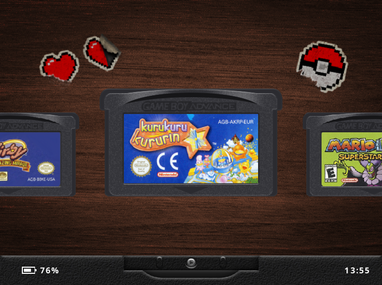

# slot-miyoo

An attempt to port [**slot**](https://slot-cfw.fyi/) — Brandon Kowalski's
Game Boy-centric frontend for the Anbernic RG SP — to the **Miyoo Mini Flip**.

Upstream lives in `upstream/slot` as a submodule, pinned to the commit this
port was last rebased onto.

```
git clone --recurse-submodules <this repo>
# or, in an existing clone:
git submodule update --init
```

## Status

**It runs on the device, and stops at the renderer — exactly as predicted.**

`task all` produces, from a clean tree, three armv7 artifacts that the handheld
could load — verified as 32-bit ARMv7-A, VFPv4 hard-float, needing nothing
beyond glibc 2.28:

| artifact | size | notes |
|---|---|---|
| `target-miyoo/rust/armv7-unknown-linux-gnueabihf/device/slot` | 4.0 MB | the frontend |
| `vendor-miyoo/gpsp_libretro.so` | 756 KB | ARM dynarec, all upstream patches |
| `vendor-miyoo/mgba_libretro.so` | 2.1 MB | all 7 upstream patches |

The whole of slot needed **exactly one** source change to compile for armv7
(`patches/0001-crash-registers-on-armv7.patch`, 6 lines: the crash handler's
register read). Everything else, the GLES pipeline included, compiles as-is —
because the `gl` crate resolves entry points at runtime, so **the GPU problem
is a runtime problem, not a compile-time one.** The binary will build, ship,
start, fail to find `libEGL.so`, and die. The software rasteriser is still the
work; see the plan.

Confirmed on hardware on 2026-10-12 (`notes/hardware.md`). `slot --init-root`
completed with exit 0 on the device, and a normal start gets this far:

```
slot: boot: start at 0.0 ms
slot: fb0 hint 752x560
slot: gl context: libEGL.so: cannot open shared object file: No such file or directory
```

Toolchain, libc, loader and binary are all correct — the device's glibc is
**2.28**, the exact version we link against. Only the renderer is missing.

## The problem in one table

slot ships for the Allwinner H700 Anbernic handhelds (RG SP, RG34XX/SP,
RG35XXSP, 35XX Plus, RG28XX). The Miyoo Mini Flip is a different machine in
every way that matters to a renderer:

| | Anbernic H700 (slot's target) | Miyoo Mini Flip |
|---|---|---|
| SoC | Allwinner H700 | SigmaStar SSD202D |
| CPU | 4x Cortex-A53, **aarch64** | 2x Cortex-A7 @1.2GHz, **armv7 (32-bit)** |
| RAM | 1 GB | **128 MB, ~101 MB usable** |
| 3D GPU | Mali-G31, **libEGL + GLES2** | **none** — 2D blitter only (SigmaStar MI_GFX) |
| Panel | 640x480 / 720x480 | 2.8" **752x560**, 32bpp, triple-buffered |
| OS | Anbernic BaseOS (Linux) | Miyoo stock / OnionOS (Linux) |

Three of those are load-bearing:

1. **No GLES2.** slot's device renderer (`crates/slot-gfx/src/fbdev.rs`) dlopens
   `libEGL.so` and builds an OpenGL ES 2.0 context on `/dev/fb0`. The SSD202D
   has no 3D core and no such library. Every pass in `pipeline.rs`, `fbo.rs`
   and `draw.rs` is GLSL. This is the port.
2. **32-bit ARM.** Upstream builds `aarch64` only (`task build:device`, and
   `file ... | grep -q aarch64` assertions throughout `taskfile.yml`). Both
   the Rust binary and the mGBA/gpSP libretro cores need an
   `armv7-unknown-linux-gnueabihf` toolchain.
3. **101 MB of usable RAM.** `MemTotal` is 103352 kB — the 128 MB on the spec
   sheet minus what the SoC reserves — with no swap and about 81 MB free at
   idle. slot composites through offscreen framebuffers and keeps wallpaper,
   label art and font atlases resident, on top of a libretro core.

## Why this is tractable anyway

The useful discovery: **`slot-ui` contains no graphics calls at all.**

```
$ grep -rl "gl::" upstream/slot/crates/slot-ui/src   # no output
```

The UI builds a flat display list and hands it over:

```rust
pub enum Draw {
    Rect   { x, y, w, h, colour: [f32; 4] },
    Tex    { x, y, w, h, tex: TexId, alpha: f32 },
    Turned { x, y, w, h, tex: TexId, alpha: f32, turn: f32 },
    Game,
    Shot   { tex: TexId },
}
```

All GL is quarantined in `slot-gfx` (~1,950 lines, of which the actual drawing
is `draw.rs`, `pipeline.rs`, `fbo.rs`, `quad.rs`, `shaders.rs`). The seam is
the `Surface` trait plus that five-variant display list. A CPU rasteriser that
honours both, writing straight into `/dev/fb0`, replaces the GLES backend
without touching a line of UI code.

So: a `software` feature alongside upstream's `host` and `device`.

## Building

Needs Docker and [go-task](https://taskfile.dev). Everything cross-builds in
`toolchain/Dockerfile`, which carries the Miyoo Mini gcc (8.3,
`arm-linux-gnueabihf`, **glibc 2.28 — the device's own libc**) alongside a
pinned Rust 1.96 with the armv7 target, so one image builds the C cores and the
Rust frontend.

```sh
task            # list tasks
task all        # cores + frontend for armv7, from scratch
task cores      # just the two libretro cores
task build      # just the frontend
task dist       # assemble the SD card tree -> ./dist
task probe      # assemble just the probe app -> ./dist-probe
task run:qemu   # run the device build here, under qemu
task glibc      # highest glibc version the binary needs (device must be >= this)
task shell      # poke around inside the toolchain container
task clean      # drop build output and un-patch the submodule
```

Choices worth knowing, with the reasoning in the scripts themselves:

- **`arm-linux-gnueabihf`, glibc, dynamic** — not musl-static. slot `dlopen`s
  its libretro cores, and a fully static binary has no dynamic loader. The
  toolchain and triple are the ones the Miyoo Mini community settled on
  (Allium, a Rust launcher for this same SoC, uses the same image).
- **`armv7-unknown-linux-gnueabihf`** for Rust and `platform=classic_armv7_a7`
  for gpSP, both with `-mtune=cortex-a7 -mfpu=neon-vfpv4`, so frontend and
  cores target one ISA. Allium uses the lower `arm-unknown-linux-gnueabihf`
  baseline; this device is a Cortex-A7, so there is no reason to give up armv7.
- **Patches, not edits.** `upstream/slot` is a pinned submodule and stays
  pristine; `task patch` applies `patches/*.patch` to its working tree and
  `task unpatch` reverts. A patch that no longer applies is a hard error, not a
  warning, so an upstream bump cannot silently drop a change.

## Plan

- [x] **armv7 toolchain.** `toolchain/Dockerfile`; `task build`.
- [x] **Cores for armv7.** Both built with upstream's patches; `task cores`.
      gpSP has `HAVE_DYNAREC=1` (ARM JIT) and is expected to be the GBA core —
      mGBA has no GBA dynarec and interprets, which at 1.2 GHz probably will not
      hold 60fps. Unmeasured.
- [x] **Probe the hardware.** Done; see `notes/hardware.md`. glibc is 2.28
      exactly, the panel is 752x560x32 and already triple-buffered, and the card
      is not mounted `noexec`.
- [ ] **Per-button evdev codes.** The probe found `event0` (`soc:gpio_keys`) and
      `event1` (the clamshell hall sensor, which slot's `SW_LID` handling can
      use), but not the individual keycodes. Needs an `evtest`-style capture.
- [x] **A dev loop.** `task run:qemu` runs the device build here and stops at
      EGL, so the rasteriser can be written and iterated without the handheld.
- [x] **Software `Surface`.** `soft/fb.rs`: mmap `/dev/fb0` and page-flip via
      `FBIOPAN_DISPLAY` across the panel's three buffers. Not yet run on the
      device.
- [x] **Software rasteriser.** `soft/raster.rs` and `soft/mod.rs`: all five
      `Draw` variants, the game plane, and the Lcd3x mask computed from the same
      `lcd3x_factors` the shader uses. It renders slot's UI correctly under
      qemu — see below. Not yet run on the device.
- [ ] **An MI_AO audio sink.** There is no ALSA on the device, and slot
      `dlopen`s `libasound`. `/config/lib/libmi_ao.so` is the replacement, behind
      slot's existing `Sink` trait. Allium's `ffi` crate binds it already.
- [ ] **A battery source.** `/sys/class/power_supply` does not exist on this
      device, so `slot-power` has nothing to read. Find how Allium does it.
- [x] **Decide the shader passes.** Lcd3x and the blue-light gain are
      implemented exactly; the bezel, split and lift paths are no-ops because
      `bezel::framed()` needs a 4:3 panel and 752x560 is not one, so the device
      never reaches them. Grid, Dot and Simpletex fall back to no effect.
- [x] **Make the rasteriser fast enough to be worth measuring.** The first
      on-device run ran but dropped frames badly. The game pass was calling
      `lcd3x_factors` per pixel — four `sin()` each, ~83 million a second over
      the game area at 60 fps. The mask is separable, so it now precomputes one
      row and one column and the inner loop is integer; the sprite path
      precomputes source columns and short-circuits transparent and opaque
      texels; the output blit uses a gain lookup, skips the identity case and
      no longer repaints the static border. Output is pixel-identical.
- [ ] **Measure.** `SLOT_TRACE_LATENCY=1` is set in the card's launch script and
      writes a per-frame breakdown to `slot.log`, of which `take>swapped` is
      this backend. Nothing above has a real frame time attached to it yet.
- [x] **Fit the panel.** Resolved by measurement rather than choice: the panel
      is **752x560**, not the 750x560 on the spec sheets, so upstream's own
      720x480 (`SCALE = 3` over 240x160) drops in with a 16px side and 40px
      top/bottom border. No non-integer scaling, no compromise. A bezel for that
      border is still to draw.
- [x] **Boot integration.** `card/App/Slot` plus an armv7
      `card/System/launch_frontend.sh`; `task dist` assembles the card tree.
      Untested on hardware.
- [ ] **Measure.** RAM headroom and sustained frame time, on-device, before
      calling anything done.

## Layout

```
card/                    what ships on the SD card
  App/                   launcher entries, stock and Onion layout
  Apps/                  launcher entries, Allium layout (*.pak)
  System/probe.sh        the hardware probe, one copy for every layout
  System/                armv7 launch script
cores/                   armv7 build scripts for the two libretro cores,
                         counterparts to upstream's aarch64 ones
  miyoo-toolchain.cmake  cross settings for mGBA's cmake build
patches/                 changes to upstream files, applied to the submodule
toolchain/Dockerfile     the cross build box
notes/hardware.md        measured device facts (empty until probed)
upstream/slot            pinned submodule, read-only
taskfile.yml             the armv7 build tasks
```

## Seeing what it draws

```sh
task shot        # renders a frame under qemu into target-miyoo/frame.png
```



That is slot's shelf drawn entirely on the CPU at 752x560 — no GPU, no EGL —
with the 720x480 canvas centred and the panel's border around it. Carts, labels,
text and alpha all land where the GL path puts them.

To get a populated shelf without ROMs, `task shot` writes a content root and
slot needs `Config/slot.state` to hold **every** key its parser requires
(`cart`, `brightness`, `blue_light`, `volume`, `muted`, `clock_set`,
`utc_offset_min` at least) — a partial file is discarded whole and you land back
on the clock screen.

## Running it without the handheld

The device build runs on an ordinary x86 machine under qemu, which is the
rasteriser's dev loop:

```sh
task binfmt      # once per boot; needs Docker, not root
task run:qemu
```

```
glibc here: ldd (Debian GLIBC 2.31-13+deb11u14) 2.31
slot: boot: start at 0.2 ms
slot: fb0 hint 3840x2160
slot: gl context: libEGL.so: cannot open shared object file: No such file or directory
```

That is the whole port in four lines. The armv7 binary **runs** — it boots,
reads the framebuffer geometry, and stops at exactly one thing: EGL. Which is
the predicted failure, now reproducible on demand without touching hardware.
`task verify:root` leans on the same trick to prove the content root `task dist`
builds is byte-for-byte what `slot --init-root` makes.

Two caveats. qemu says nothing about **speed** — it cannot tell you whether a
Cortex-A7 holds 60fps, and that question is settled only on the device. And the
`fb0` it reports is the host's, not a 750x560 panel.

`task binfmt` registers a host-wide qemu handler from a privileged container
(Docker is enough, no root). It lasts until reboot; undo it with
`docker run --privileged --rm tonistiigi/binfmt --uninstall arm`.

## Getting it onto the card

Both trees are built to be copied **into the card root** — the directory the
device sees as `/mnt/SDCARD`, where `App/`, `Roms/` and friends already live.
Nothing is reflashed and nothing existing is deleted; the copy merges into
`App/` and adds `System/` beside it.

### The probe — do this one first

This is the useful one today, and it needs no build, no ADB and no shell:

```sh
task probe                      # writes ./dist-probe
cp -R dist-probe/. /media/<you>/<card>/
sync
```

Then on the handheld: **Apps → "slot probe"**. The screen may not change — it
writes a file and exits, taking a second or two. Put the card back in your
machine and read `slot-probe.txt` at its root. That file answers everything
`notes/hardware.md` is waiting on, including the two questions that decide the
next move: whether the device's glibc is >= 2.28, and whether any `libEGL`
exists.

### slot itself — expect it to fail, informatively

```sh
task dist                       # cores + frontend + content root -> ./dist
cp -R dist/. /media/<you>/<card>/
sync
```

Adds **Apps → "slot"**. It will start and die, because the device has no
`libEGL.so`; `slot.log` at the card root will say so. That is the expected
outcome at this stage, and worth doing only because the failure message is
evidence. ROMs, if you want them in place for later, go unzipped in
`Games/GBA`, `Games/GB` and `Games/GBC`, and GBA needs `BIOS/gba_bios.bin`.

### Controls on the Mini Flip

The button map is in `patches/0003`; the gestures are upstream's, from
`crates/slot-input/src/gesture.rs`. The ones worth knowing:

| gesture | action |
|---|---|
| **hold MENU ~1 s** | **eject the cart, back to the shelf** |
| tap MENU | quick menu (brightness, volume) |
| double-tap MENU | polaroids |
| SELECT held, then MENU | game menu |
| hold POWER ~1 s | power menu |

slot boots straight into whatever cart was last seated — that is intended, not
a fault: the cart is remembered in `Config/slot.state` and re-seated at startup,
so the handheld behaves as though you left it in the slot. Ejecting clears it
and the next boot lands on the shelf.

On this device MENU is `KEY_ESC`, A is `KEY_SPACE`, B is `KEY_LEFTCTRL` — see
`notes/hardware.md` for the full table.

## Caveats worth reading before you copy

- **Keep a backup of the card.** Nothing here deletes, but the stock firmware
  is particular and a known-good copy costs nothing.
- **Card format:** whatever the device already boots from — don't reformat.
  FAT32 and exFAT are both routinely mounted `noexec`, which is why both launch
  scripts hand the binary to `ld.so` rather than executing it.
- **`/mnt/SDCARD` is the card root**, confirmed against a live Allium install.
  The scripts still derive it from their own location rather than hardcoding it,
  so a differently-mounted card works too.
- **Three launcher layouts ship, and the unused ones are ignored.** Stock and
  Onion read `App/<Name>/config.json`; Allium reads `Apps/<Name>.pak/`. Both are
  in the tree with the same `config.json` schema, and the probe itself lives once
  at `System/probe.sh` with a thin entry per layout. No `icon` key is set — it is
  optional, and the path conventions differ per launcher, so an icon that works
  on one shows up broken on another.
- **If the app doesn't show up**, the launcher has cached its list — reboot the
  device. On Onion, a Package-Manager visit also refreshes it.

## Probing the device

The app above is the no-shell route and collects all of this. If you do have a
shell (ADB over USB, or telnet/SSH depending on firmware), the same ground by
hand:

```sh
uname -a                              # kernel, confirm armv7l
ldd --version                         # must be >= 2.28, what we link against
cat /proc/cpuinfo /proc/meminfo
cat /sys/class/graphics/fb0/virtual_size /sys/class/graphics/fb0/bits_per_pixel
cat /sys/class/graphics/fb0/modes /sys/class/graphics/fb0/stride
ls /dev/input/ ; cat /proc/bus/input/devices    # button map
ls /sys/class/power_supply/                     # battery, for slot-power
ls /usr/lib/ | grep -iE 'egl|gles|mali|mi_'     # expect no EGL, maybe MI_GFX
free -m
```

Land the results in `notes/hardware.md` — the plan's resolution and input work
depends on them.

## Credit and licence

slot is by [Brandon Kowalski](https://github.com/BrandonKowalski/slot) and is
GPL-3.0-or-later; this port inherits that. It is an unofficial, unaffiliated
effort — please don't send slot's issue tracker bug reports about a Miyoo.
