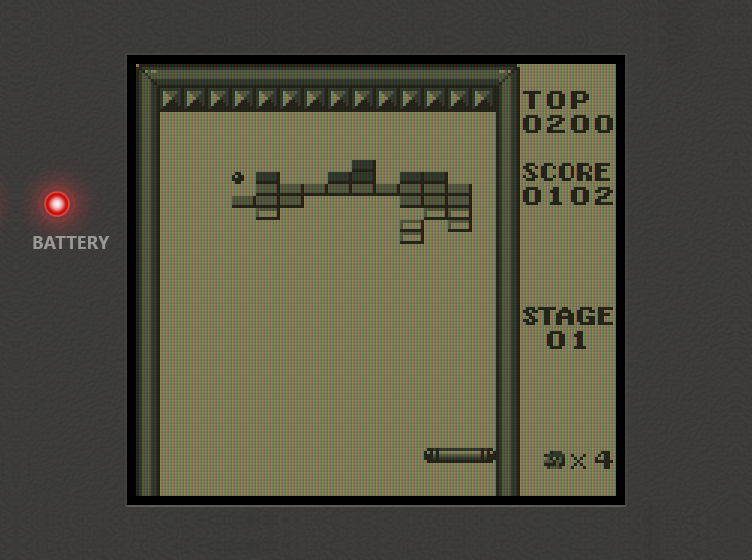

# slot on the Miyoo Mini Flip

[**slot**](https://slot-cfw.fyi/) is Brandon Kowalski's Game Boy frontend for
the Anbernic RG SP: you pick a cartridge off a shelf and push it into a
console. This is an unofficial port of it to the **Miyoo Mini Flip**, a
clamshell handheld with two Cortex-A7s, 101 MB of usable RAM and **no GPU at
all** — so everything you see is drawn on the CPU.


It plays Game Boy, Game Boy Color and Game Boy Advance games on real hardware,
with saves, save states, rewind, sleep-on-close and a console body drawn around
the picture.

## install it

Download the latest `slot-miyoo-*-flip.zip` from
[Releases](https://github.com/deanmarano/slot-miyoo/releases), unzip it into
the root of your SD card, and find **slot** in your launcher's app list.

That's the whole install — it needs no custom firmware and replaces nothing.
It works on Miyoo's own firmware as well as on Allium, and your games go in
`Games/GB`, `Games/GBC` and `Games/GBA` on the card.
[**docs/INSTALL.md**](docs/INSTALL.md) is the full page: BIOS files, bezels,
booting straight into slot, and what to do when something is wrong.

| | |
|---|---|
| **hold MENU ~1 s** | **eject the cart, back to the shelf** |
| tap MENU | the menu — screen, bezels, palettes, save states |
| double-tap MENU in a game | straight to States |
| hold POWER ~1 s | power menu |
| L1 / R1 in a GB or GBC game | stretch / actual size |
| **START on the shelf, GBA cart** | **core picker — pick gpSP for GBA** |

slot comes back up in whatever cart was last in the slot. That's deliberate;
eject to get the shelf back.

## what works

Measured on the handheld, not inferred from a build.

| | |
|---|---|
| GB, GBC, GBA | yes — GBA on gpSP, which has an ARM JIT |
| frame budget | backend 8.2 ms of a 16.86 ms frame, core 6.3 ms |
| saves, save states, rewind | yes, including MBC2's odd 512x4 bits |
| big carts | 32 MB ROMs (Mother 3) play on both cores |
| bezels | a Game Boy, Color or Advance SP body per console |
| lid | closing it saves, darkens the panel, powers off after 3 min |
| battery, buttons, audio | yes; audio sits ~100 ms behind the picture |
| **two-player link** | **written, never played — assume it doesn't work** |

Sixteen carts have been played through on the device across the three
platforms. The install path is tested on stock firmware (build 202510011046)
and on an Allium card; nobody has tried Onion.



## build it

Needs Docker and [go-task](https://taskfile.dev). One image cross-builds the
Rust frontend and both C cores for armv7 against the device's own glibc 2.28.

```sh
git clone --recurse-submodules https://github.com/deanmarano/slot-miyoo
cd slot-miyoo

task            # list every task
task all        # cores + frontend for armv7, from a clean tree
task release    # the zip a user installs -> ./release
task run:qemu   # run the device build on this machine, under qemu
task shell      # poke around inside the toolchain container
```

Upstream lives in `upstream/slot` as a pinned submodule and stays pristine:
every change this port makes is a patch in `patches/`, applied to its working
tree by `task patch`. A patch that no longer applies is a hard error, so an
upstream bump cannot quietly drop one.

The port exists because `slot-ui` makes no graphics calls — it emits a display
list, and all the GL sits behind one `Surface` trait. The port adds a third
backend beside upstream's desktop and GLES2 ones: a software rasteriser writing
to a mmapped `/dev/fb0`. Nothing above that seam changed.

- [**notes/port-log.md**](notes/port-log.md) — how the port works and why,
  patch by patch: the renderer, memory, input, power, audio, and what's still
  open.
- [**notes/hardware.md**](notes/hardware.md) — everything measured off the
  device: the panel, the frame budget, the full button map, the traps.
- [**docs/link.md**](docs/link.md) — two-player, as far as it got.
- [**notes/variants.md**](notes/variants.md) — the other Miyoo models.

## credit and licence

slot is by [Brandon Kowalski](https://github.com/BrandonKowalski/slot) and is
GPL-3.0-or-later; this port inherits that. It is unofficial and unaffiliated —
please don't send slot's issue tracker bugs about a Miyoo. The sticker in the
app says as much, for anyone who reads the device before the README.
